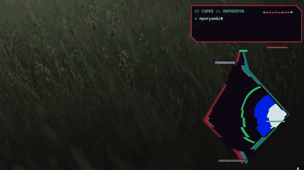
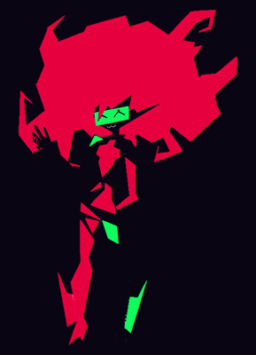

<p align="center">
  
</p>

<p align="center">
  
  
  
  
  
</p>

<p align="center">
  <b>Капри</b> — голосовой ассистент в стиле киберпанка. Живёт поверх окон, появляется с глитч-вспышками,<br>
  слушает команды, управляет компьютером и общается с помощью локальной нейросети.
</p>

> **О проекте.** Это кастомная, Open-Source сборка Капри. В отличие от официальной платной версии, здесь полностью реализован локальный ИИ (через LM Studio), RPG-система, магазин и мини-игры. Текущий код на Python — это прототип. В планах переписать ядро на **Rust** для максимальной производительности.

<p align="center">
  
  &nbsp;
  
</p>

---

## ✨ Что умеет (Особенности)

| | |
|---|---|
| **Локальный ИИ** | Интеграция с **LM Studio**. Никаких API-ключей, работает полностью офлайн. |
| **RPG и Экономика** | Уровни, опыт (XP), внутриигровая валюта ($). Зарабатывайте деньги, выполняя команды. |
| **Магазин скинов** | Покупайте и надевайте скины (Неон, Токсин, Лёд и др.), меняющие цвет Капри. |
| **Мини-игры** | Полноценные шахматы против ИИ прямо на рабочем столе. |
| **Физика** | Капри можно брать мышкой, **кидать** (она отскакивает от краев экрана) и **гладить**. |
| **Интеграции** | **Discord RPC** (статус, подсчет кликов) и **Spotify** (определение текущего трека). |
| **Голос** | Потоковый синтез речи (Edge TTS/Silero) и распознавание (Vosk + Google). |
| **Управление ПК** | Открытие программ, поиск в Google, управление окнами, громкостью и яркостью. |

> **Работает и без ИИ** — все базовые команды доступны сразу после установки.

---

## 🚀 Установка

**Нужно:** Windows 10 или 11, микрофон, интернет на время установки.

### 1. Установи Python
Скачай **Python 3.12**: [установщик для Windows (64-bit)](https://www.python.org/ftp/python/3.12.8/python-3.12.8-amd64.exe).
При установке **обязательно поставь галочку «Add python.exe to PATH»**.

### 2. Установи зависимости
Откройте терминал в папке с проектом и выполните:
```bash
pip install -r requirements.txt
pip install chess pypresence pynput winrt-Windows.Media.Control
