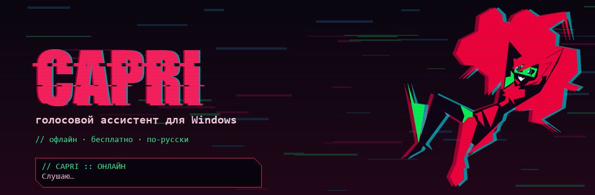

  

  
  
  
  
  

  <b>Капри</b> — голосовой ассистент в стиле киберпанка. Живёт поверх окон, появляется с глитч-вспышками, 
  слушает команды, управляет компьютером и общается с помощью локальной нейросети.

> **О проекте.** Это кастомная, Open-Source сборка Капри. В отличие от официальной платной версии, здесь полностью реализован локальный ИИ (через LM Studio), RPG-система, магазин и мини-игры. Текущий код на Python — это прототип. В планах переписать ядро на **Rust** для максимальной производительности.

---

## ✨ Что умеет (Особенности)

| | |
|---|---|
| **Локальный ИИ** | Интеграция с **LM Studio**. Никаких API-ключей, работает полностью офлайн. |
| **RPG и Экономика** | Уровни, опыт (XP), внутриигровая валюта ($). Зарабатывайте деньги, выполняя команды. |
| **Магазин скинов** | Покупайте и надевайте скины (Неон, Токсин, Лёд и др.), меняющие цвет Капри. |
| **Мини-игры** | Полноценные шахматы против ИИ прямо на рабочем столе. |
| **Физика** | Капри можно брать мышкой, **кидать** (она отскакивает от краев экрана) и **гладить**. |
| **Интеграции** | **Discord RPC** (статус, подсчет кликов) и **Spotify** (определение текущего трека). |
| **Голос** | Потоковый синтез речи (Edge TTS/Silero) и распознавание (Vosk + Google). |
| **Управление ПК** | Открытие программ, поиск в Google, управление окнами, громкостью и яркостью. |

> **Работает и без ИИ** — все базовые команды доступны сразу после установки.

---

## 🚀 Установка

**Нужно:** Windows 10 или 11, микрофон, интернет на время установки.

### 1. Установи Python
Скачай **Python 3.12**: [установщик для Windows (64-bit)](https://www.python.org/ftp/python/3.12.8/python-3.12.8-amd64.exe).
При установке **обязательно поставь галочку «Add python.exe to PATH»**.

### 2. Скачай проект
Зелёная кнопка **Code → Download ZIP** вверху страницы. **Распакуй** архив в удобную папку (например, `Документы\capri`). Из архива запускать нельзя.

### 3. Запусти setup.bat
Установит базовые библиотеки и распакует офлайн-модель распознавания речи. Дождись надписи «Готово».

> Если Windows покажет «Windows защитила ваш компьютер» — **«Подробнее» → «Выполнить в любом случае»**.

### 4. Установи дополнительные библиотеки
Откройте терминал в папке с проектом и выполните:
pip install chess pypresence pynput winrt-Windows.Media.Control

### 5. Настрой локальный ИИ (LM Studio)
1. Скачай и установи [LM Studio](https://lmstudio.ai/).
2. Скачай любую модель (например, **Qwen2.5-3B-Instruct** для слабых ПК или **Qwen2.5-7B-Instruct** для мощных).
3. Перейди во вкладку **Local Server** и нажми **Start Server** (порт должен быть `1234`).
4. В файле `config.json` пропиши название вашей модели в строке `"local_model": "имя-модели"`.

### 6. Запусти run.bat
Капри появится и поздоровается. Кликни по ней правой кнопкой мыши, чтобы открыть радиальное меню.

---

## 🛠️ Настройка (config.json)

Все настройки хранятся в `config.json`. Вот основные из них:

| Параметр | Что меняет |
|---|---|
| `local_model` | Название модели в LM Studio (например, `qwen2.5-3b-instruct`). |
| `language` | Язык интерфейса и голоса: `"ru"` (русский) или `"en"` (английский). |
| `tts_engine` | Движок озвучки: `"edge"` (облачный, красивый) или `"silero"` (локальный, мгновенный). |
| `voice_fx` | Сила цифровых эффектов голоса (`0` — чистый, `1.8` — сильный глитч). |
| `wake_words` | Слова, на которые Капри откликается. |
| `barge_in` | Можно ли перебивать Капри голосом (`true`/`false`). |
| `chatter` | Появляется ли она сама время от времени (`true`/`false`). |

---

## 📂 Структура проекта

*   `main.py` — Главный файл запуска и логика работы.
*   `local_ai.py` — Модуль связи с локальной нейросетью (LM Studio).
*   `voice.py` — Распознавание (STT) и синтез речи (TTS).
*   `avatar.py` — Окно-аватар, физика, отрисовка интерфейса.
*   `shop_dialog.py`, `levels_dialog.py` — Окна магазина и уровней.
*   `chess_game.py` — Мини-игра шахматы.
*   `discord_rpc.py` — Интеграция с Discord.
*   `spotify_integration.py` — Отслеживание медиа-плеера.

---

## ❓ Частые проблемы

| Проблема | Что сделать |
|---|---|
| **ИИ не отвечает** | Проверьте, запущен ли сервер в LM Studio и нажата ли кнопка «Start Server». Проверьте название модели в `config.json`. |
| **Голос долго думает** | Поменяйте в `config.json` `"tts_engine": "silero"`. Это локальный синтезатор, он работает мгновенно. |
| **Не видит Discord** | Убедитесь, что приложение Discord запущено. Проверьте `CLIENT_ID` в `discord_rpc.py`. |
| **Ошибка PermissionError** | Удалите все файлы `capri_tts_*.wav` и `*.mp3` из папки `%TEMP%`. |
| **Ошибка библиотек** | Убедитесь, что вы установили их именно для Python 3.12 (используйте `C:\Users\...\Python312\python.exe -m pip install ...`). |

---

## 📜 Лицензия

Код проекта открыт под лицензией **[MIT](LICENSE)**. Вы можете свободно изменять и распространять его.

**Отказ от ответственности:** Персонаж Капри и вселенная Cyberpunk: Edgerunners принадлежат их правообладателям. Это некоммерческий фан-проект. Модель распознавания речи (Vosk) распространяется под лицензией Apache 2.0.
